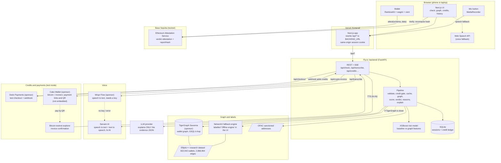
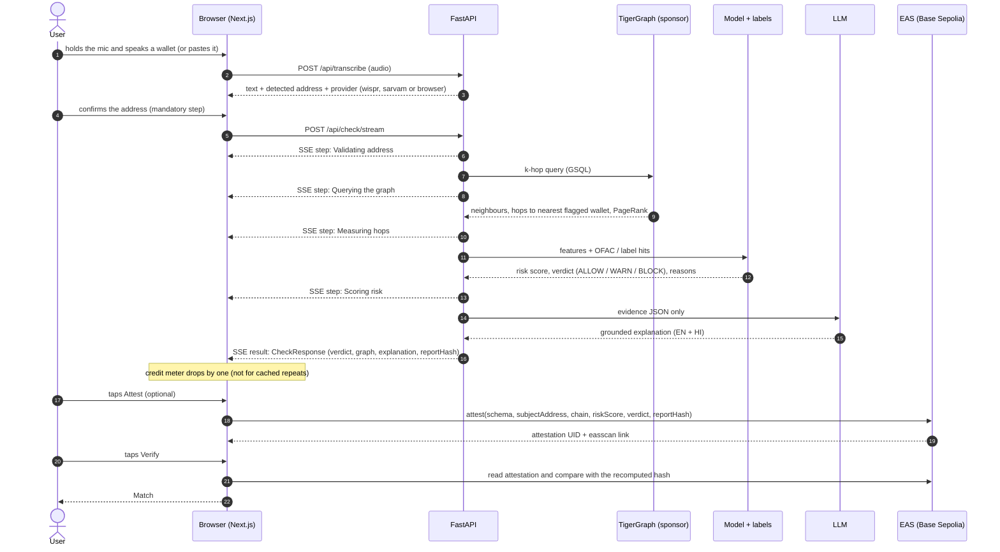

# Cryptiq architecture

Say or paste a Bitcoin wallet. Cryptiq looks it up in a graph database, scores it, explains the result in English or Hindi, and can keep proof on-chain.
A risk signal, not an accusation. It runs on a research dataset (Elliptic++), not the live blockchain.

Sponsor technology is labelled **(sponsor)**. Everything else is open source or a free/test-mode service. Sponsor names are plain text, not endorsements.

## System

## One check, step by step

## Layers and trust

| Layer | Where | What it must never do |
|---|---|---|
| UI | `frontend/` (Vercel) | ask for or store a seed phrase or private key; show invented numbers; call ALLOW "safe" |
| API | `backend/` (Fly.io) | send anything but the evidence JSON to the LLM; charge for cached repeats |
| Graph | TigerGraph (sponsor), NetworkX fallback | claim TigerGraph answered when the fallback did |
| Chain | Base Sepolia **testnet** only | use real money, or present an attestation as a legal verdict |

The proxy is same-origin on purpose: the browser only talks to the frontend origin and Next.js forwards `/api/*` to `BACKEND_URL`,
so the `cryptiq_sid` session cookie stays first-party (credits and payments depend on it).

See also: `docs/api-contract.md` (the API), `docs/CREDITS.md` (third-party code and datasets), `frontend/DECISIONS.md`, `backend/DECISIONS.md`.
